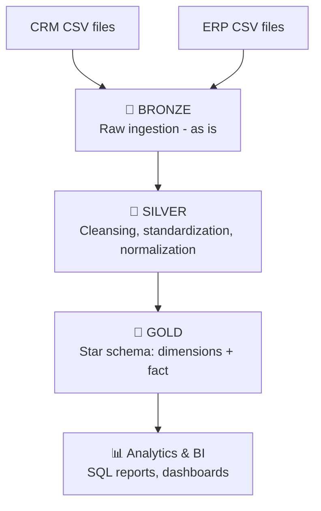
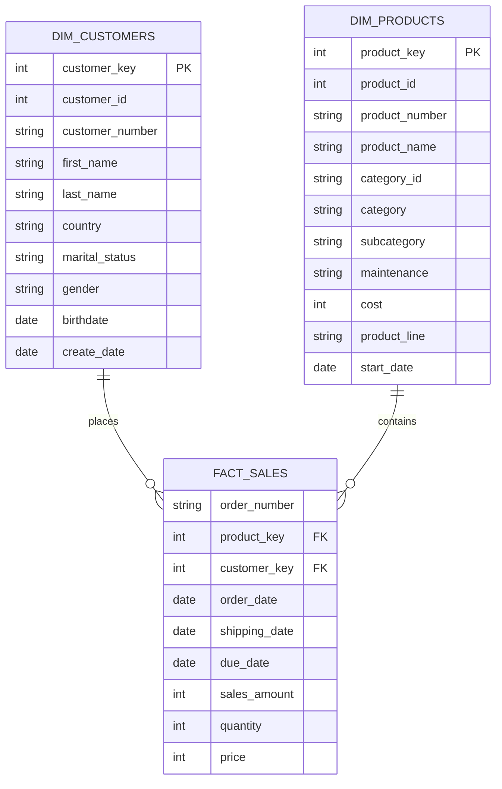

# 🏗️ Enterprise Data Warehouse & Analytics Project

[](https://www.microsoft.com/en-us/sql-server/)
[](https://docs.microsoft.com/en-us/sql/ssms/download-sql-server-management-studio-ssms)
[](#-data-architecture)
[](https://git-scm.com/)

An end-to-end modern data warehousing solution built on **SQL Server** using the **Medallion Architecture** (Bronze, Silver, Gold). The project integrates raw datasets from two disparate source systems (**ERP** and **CRM**) into a unified **Star Schema** to drive analytics on customer behavior, product performance and sales trends.

---

## 📑 Table of Contents

1. [Project Overview](#-project-overview)
2. [Data Architecture](#-data-architecture)
3. [Key Concepts](#-key-concepts)
4. [Project Requirements](#-project-requirements)
5. [Source Data](#-source-data)
6. [Pipeline Details](#-pipeline-details)
7. [Data Model (Gold Layer)](#-data-model-gold-layer)
8. [Data Quality Checks](#-data-quality-checks)
9. [Analytics & Reporting](#-analytics--reporting)
10. [Naming Conventions](#-naming-conventions)
11. [Tools & Technologies](#-tools--technologies)
12. [Repository Structure](#-repository-structure)
13. [Getting Started](#-getting-started)
14. [Design Decisions & Trade-offs](#-design-decisions--trade-offs)
15. [Future Improvements](#-future-improvements)

---

## 📖 Project Overview

This project covers the full lifecycle of modern data warehousing and business intelligence:

* **Architecture Design** – a structured 3-layer warehouse (Bronze, Silver, Gold).
* **ETL/ELT Pipeline Development** – extracting raw CSV files, cleansing and transforming data, loading into modeled layers using stored procedures.
* **Data Modeling** – dimensional model (fact + dimensions) optimized for analytical queries.
* **Business Intelligence & SQL Analytics** – advanced SQL to answer key business questions.

---

## 🏗️ Data Architecture




| Layer | Object type | Load method | Transformations | Audience |
| :--- | :--- | :--- | :--- | :--- |
| **Bronze** | Tables | Batch, full load (`TRUNCATE` + `BULK INSERT`) | None – data kept as-is | Data engineers |
| **Silver** | Tables | Batch, full load (`TRUNCATE` + `INSERT`) | Cleansing, standardization, normalization, deduplication, derived columns | Data engineers, analysts |
| **Gold** | Views | No load (computed at query time) | Integration, business rules, aggregations, star schema | Analysts, BI tools |

### Data Flow (lineage)


---

## 💡 Key Concepts

| Concept | Meaning in this project |
| :--- | :--- |
| **Data Warehouse** | Central, analysis-oriented database (OLAP) integrating several sources. |
| **ETL vs ELT** | Here: **ELT** – raw data is loaded first (Bronze), then transformed inside SQL Server. |
| **Medallion Architecture** | Progressive refinement of data quality across Bronze → Silver → Gold. |
| **Star Schema** | One central fact table surrounded by dimension tables; simple and fast for analytics. |
| **Fact table** | Numeric measures (sales, quantity, price) + foreign keys. |
| **Dimension table** | Descriptive context (who, what, where). |
| **Surrogate key** | Artificial key (`ROW_NUMBER()`), independent from source system keys. |
| **Grain** | One row of `fact_sales` = one product on one order line. |
| **Full load** | The whole table is truncated and reloaded at each run. |
| **Data lineage** | Ability to trace a Gold column back to its source CSV. |
| **SCD** | Slowly Changing Dimensions – **not used** here (latest data only). |

---

## 🚀 Project Requirements

### 1. Building the Data Warehouse (Data Engineering)
* **Data Sources**: ingest raw datasets from **ERP** and **CRM**, provided as CSV files.
* **Data Quality**: detect and fix missing values, duplicates, type inconsistencies and structural issues.
* **Integration**: combine both sources into a cohesive relational model for ad-hoc queries.
* **Scope**: latest dataset only (no historization / SCD Type 2).
* **Documentation**: data dictionary, ERD and pipeline documentation.

### 2. Business Intelligence & Analytics (Data Analysis)
* **Customer Behavior** – acquisition, retention, lifetime value, demographic segmentation.
* **Product Performance** – top/bottom products, sales volume, category contribution.
* **Sales Trends** – seasonality, regional performance, period-over-period velocity.

---

## 📥 Source Data

| System | File | Content |
| :--- | :--- | :--- |
| **CRM** | `cust_info.csv` | Customer master data (id, key, name, marital status, gender, creation date) |
| **CRM** | `prd_info.csv` | Product master data (id, key, name, cost, line, start/end date) |
| **CRM** | `sales_details.csv` | Transactional sales (order number, product key, customer id, dates, sales, quantity, price) |
| **ERP** | `CUST_AZ12.csv` | Extra customer data (birth date, gender) |
| **ERP** | `LOC_A101.csv` | Customer location (country) |
| **ERP** | `PX_CAT_G1V2.csv` | Product categories (category, subcategory, maintenance) |

> Adapt file/column names to your own dataset if they differ.

---

## ⚙️ Pipeline Details

### 🥉 Bronze – Raw Ingestion
* One table per CSV file, columns mirror the source (no transformation).
* Loaded with `BULK INSERT` (`FIRSTROW = 2`, `FIELDTERMINATOR = ','`, `TABLOCK`).
* Stored procedure `bronze.load_bronze`: `TRUNCATE` → `BULK INSERT`, per-table and total duration logging (`DATEDIFF`), error handling with `TRY…CATCH`.

### 🥈 Silver – Cleansing & Standardization
Stored procedure `silver.load_silver` (`TRUNCATE` → `INSERT … SELECT`).

| Issue | Technique |
| :--- | :--- |
| Duplicates / multiple versions of the same key | `ROW_NUMBER() OVER (PARTITION BY key ORDER BY date DESC)` → keep rank 1 |
| Unwanted spaces | `TRIM()` |
| Missing values | `ISNULL`, `COALESCE`, default value `'n/a'` |
| Coded values (`M/F`, `S/M`, country codes) | `CASE WHEN` → full readable labels |
| Invalid dates / integer dates (`YYYYMMDD`) | `CASE WHEN … THEN NULL`, `CAST` to `DATE` |
| Inconsistent sales / price / quantity | Recompute: `sales = quantity × ABS(price)`; `price = sales / NULLIF(quantity, 0)` |
| Product end date | Derived with `LEAD()` over the product start date |
| Key mismatches between systems | `REPLACE` / `SUBSTRING` to align keys |
| Traceability | Metadata column `dwh_create_date DATETIME2 DEFAULT GETDATE()` |

### 🥇 Gold – Business Layer
Views built on top of Silver:
* Joins CRM + ERP sources.
* Applies business rules (CRM is the master for gender; ERP is the fallback).
* Generates **surrogate keys** with `ROW_NUMBER()`.
* Filters out historical product versions (`prd_end_dt IS NULL`).

---

## ⭐ Data Model (Gold Layer)



| Object | Type | Role |
| :--- | :--- | :--- |
| `gold.dim_customers` | Dimension | CRM + ERP customer data, location and demographics |
| `gold.dim_products` | Dimension | CRM products enriched with ERP categories |
| `gold.fact_sales` | Fact | Sales transactions linked to both dimensions |

---

## ✅ Data Quality Checks

Executed after each layer (scripts in `tests/` or the layer folders):

* **Primary key uniqueness** – `GROUP BY key HAVING COUNT(*) > 1`.
* **Unwanted spaces** – `WHERE col <> TRIM(col)`.
* **Standardization** – `SELECT DISTINCT` on low-cardinality columns.
* **Invalid dates** – end date before start date, out-of-range values.
* **Business rule consistency** – `sales = quantity × price`, no NULL or negative values.
* **Referential integrity (Gold)** – `LEFT JOIN` fact → dimensions, `WHERE key IS NULL` must return 0 rows.
* **Row counts** – compare Bronze vs Silver to explain every difference.

---

## 📊 Analytics & Reporting

### Customer Behavior
* New customers per period, distribution by country / gender / age group.
* Customer segmentation: **VIP** (long history + high spend), **Regular**, **New**.
* Lifetime value, recency, order frequency.

### Product Performance
* Top / bottom N products by revenue (`RANK`, `DENSE_RANK`, `TOP`).
* Revenue and share per category (`SUM() OVER()`).
* Cost-based product segmentation.

### Sales Trends
* Sales by year / month (`DATETRUNC`, `DATEPART`, `FORMAT`).
* **Running total** and **moving average** (`SUM/AVG() OVER (ORDER BY …)`).
* **Period-over-period change** (YoY / MoM) with `LAG()`.
* **Performance vs average** (`AVG() OVER (PARTITION BY …)`).
* **Part-to-whole** analysis (category share of total sales).

**SQL features used:** CTEs, window functions (`ROW_NUMBER`, `RANK`, `LAG`, `LEAD`, `NTILE`, `SUM/AVG OVER`), `CASE WHEN`, `COALESCE`, `NULLIF`, `DATEDIFF`, aggregations, views, stored procedures, `TRY…CATCH`.

---

## 🧾 Naming Conventions

* **Style**: `snake_case`, English.
* **Tables**: `<sourcesystem>_<entity>` in Bronze/Silver (e.g. `crm_cust_info`, `erp_loc_a101`).
* **Gold objects**: `<category>_<entity>` – `dim_` for dimensions, `fact_` for facts.
* **Surrogate keys**: `<entity>_key` (e.g. `customer_key`).
* **Technical columns**: `dwh_<name>` (e.g. `dwh_create_date`).
* **Stored procedures**: `load_<layer>` (e.g. `silver.load_silver`).

---

## 🛠️ Tools & Technologies

* **Database Engine**: SQL Server
* **IDE**: SQL Server Management Studio (SSMS)
* **Version Control**: Git & GitHub
* **Diagramming**: [draw.io](https://app.diagrams.net/) (architecture, data flow, ERD)
* **Project Management**: Notion

---

## 📁 Repository Structure

```text
.
├── 00_setup/        # Database & schemas initialization (bronze, silver, gold)
├── 01_bronze/       # DDL for raw tables + BULK INSERT procedure
├── 02_silver/       # Silver DDL + cleansing/transformation procedure
├── 03_gold/         # Star schema views (dim_customers, dim_products, fact_sales)
├── 04_analytics/    # Business analysis queries
├── docs/            # Diagrams (architecture, data flow, ERD), data dictionary
│   ├── architecture_diagram.png
│   └── data_model_erd.png
├── data/            # Source CSV files (ERP & CRM)
└── README.md
```

---

## ▶️ Getting Started

### Prerequisites
* SQL Server (Express/Developer edition) + SSMS.
* Source CSV files from the `data/` folder.

### Steps
1. **Clone** the repository
   ```bash
   git clone https://github.com/maryem37/Data_WareHouse_Project.git
   ```
2. **Initialize** the database and schemas – run `00_setup/` script (creates `DataWarehouse` DB with `bronze`, `silver`, `gold` schemas).
3. **Bronze** – create tables, then update the CSV paths in the `BULK INSERT` statements and run:
   ```sql
   EXEC bronze.load_bronze;
   ```
4. **Silver** – create tables, then run:
   ```sql
   EXEC silver.load_silver;
   ```
5. **Gold** – create the views (`dim_customers`, `dim_products`, `fact_sales`).
6. **Analytics** – run the queries in `04_analytics/`.

> ⚠️ SQL Server must have read access to the CSV folder path used in `BULK INSERT`.

---

## 🧠 Design Decisions & Trade-offs

| Decision | Reason | Trade-off |
| :--- | :--- | :--- |
| Medallion (3 layers) | Traceability, reprocessing without re-extraction, clear separation of concerns | More objects to maintain |
| ELT approach | Leverage SQL Server engine for transformations | Raw data stored twice |
| Full load | Small dataset, simple and reliable | Not scalable → incremental load needed for large volumes |
| Gold as **views** | Always in sync with Silver, no extra storage | Computed at query time (could be materialized) |
| Surrogate keys | Independent from source keys, stable joins | Extra generation logic |
| Star schema | Fast, simple queries for BI | Some denormalization / redundancy |
| No SCD2 | Scope limited to the latest data | No history of changes |
| CRM as master source | Business decision to resolve conflicts | ERP used only as fallback |

---

## 🔮 Future Improvements

* **Incremental loading** (watermark, CDC, `MERGE`).
* **Orchestration** (SQL Server Agent, Airflow, Azure Data Factory).
* **Performance**: indexes, columnstore, materialized/indexed views, partitioning.
* **Automated data quality tests** and alerting.
* **CI/CD** for SQL scripts (GitHub Actions).
* **SCD Type 2** for historization.
* **BI dashboards** (Power BI) on top of the Gold layer.
* **Data catalog / lineage** tooling.

---

## 👩‍💻 Author

**Mariem** – Computer Engineering student (ENIS), focused on AI/ML, MLOps and data/backend engineering.
GitHub: [@maryem37](https://github.com/maryem37)
